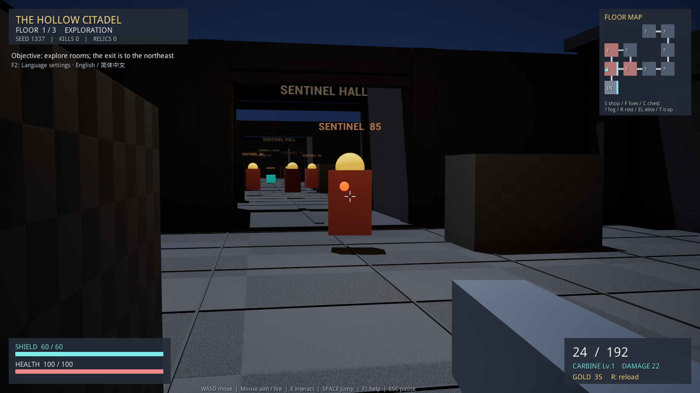
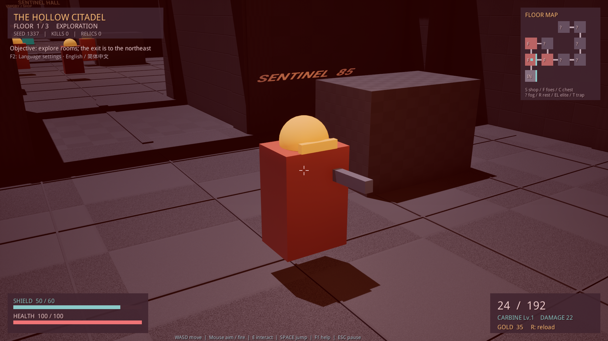
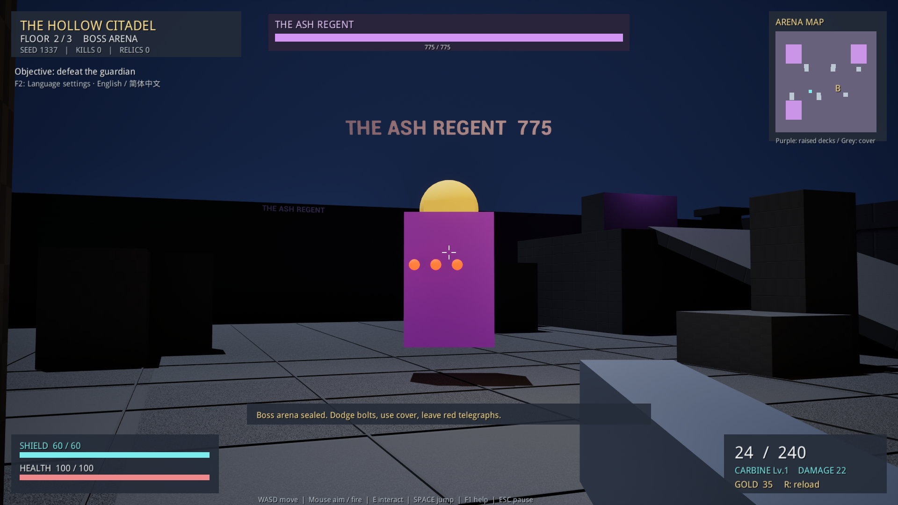
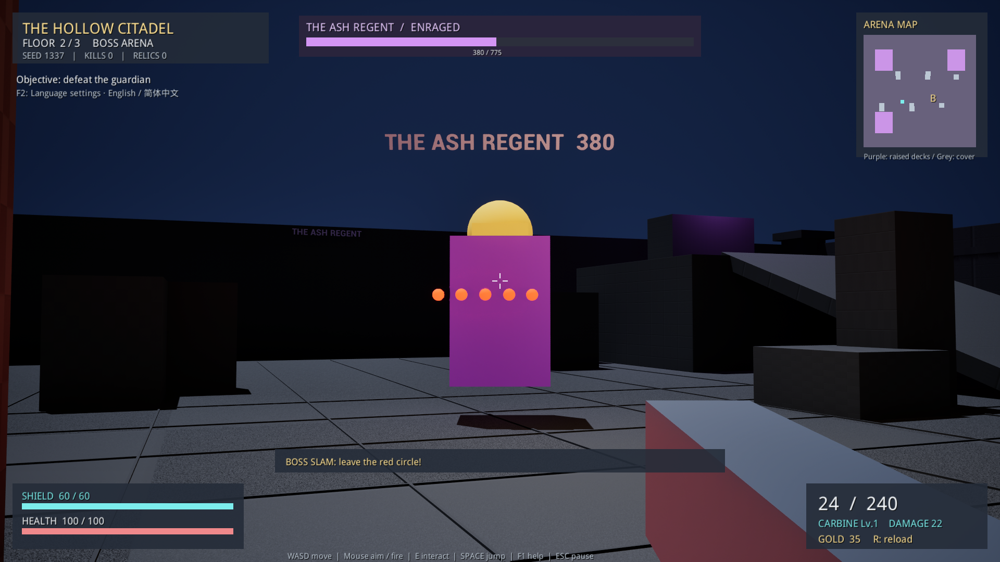
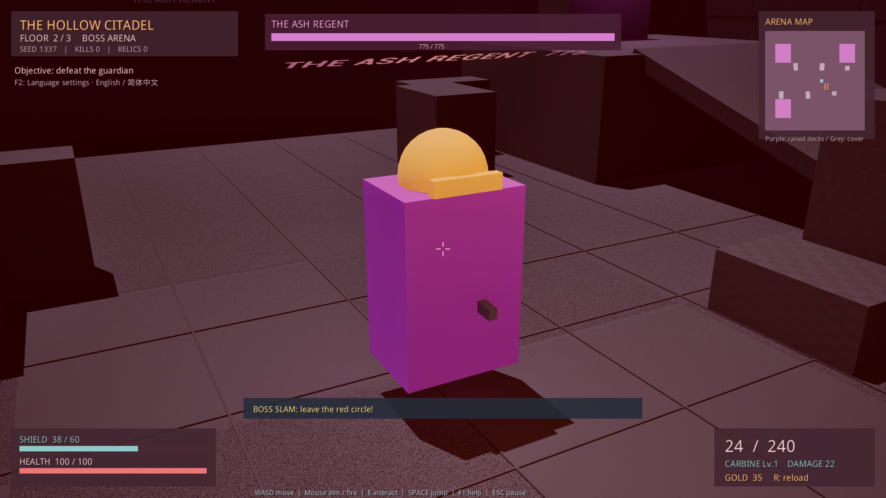
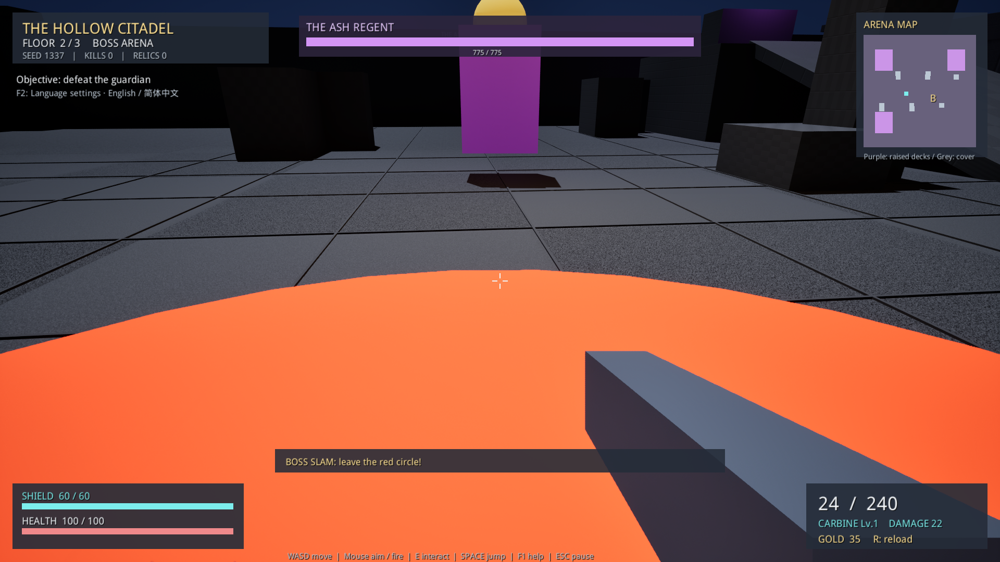

# Enemy AI: Behavior Trees and In-Game Tasks

The Hollow Citadel demo — presentation notes, 14 October 2026.

The demo uses two native Unreal Engine Behavior Tree assets: **BT_CastleGuard** and **BT_CastleBoss**. Both share **BB_CastleEnemy** and are controlled by **ACastleAIController**. Elite guards reuse the guard tree with increased health and damage.

## 1. Guard Behavior Tree

```text
ROOT
└── Selector: Combat or hold current state
    │
    ├── Attached Service: Update target, sight and pending slam
    │   └── Refresh target, distance, visibility and Blackboard values
    │
    ├── Combat branch [higher priority]
    │   ├── Decorator: IsOperational is true
    │   ├── Decorator: InDecisionRange is true
    │   └── Simple Parallel: Pursuit and combat simultaneously
    │       ├── Main Task: Face and chase / stop
    │       └── Background Task: Melee / single projectile
    │
    └── Task: Out of range: hold; inactive: stop
```

The Service is attached to the Selector; it is not a third selectable branch. It keeps the shared information up to date while the tree runs.

The Selector tries the combat branch first. Both Decorators must be true. The enemy must be alive and active, the player must be alive, level generation must be complete, and the run must not have ended. For a guard, the player must also be within 2,100 cm of the enemy and within 2,600 cm of its home position in the horizontal plane.

When these conditions are satisfied, Simple Parallel runs movement and attack together. The guard can therefore shoot while pursuing the player.

### Movement task: Face and chase / stop

The guard faces the player and checks movement every 0.45 seconds. If the distance exceeds 450 cm, or visibility is blocked, AIController calls MoveToActor with an acceptance radius of 320 cm. Otherwise, it stops moving. Stopping movement does not stop the attack task.

### Attack task: Melee / single projectile

The task checks visibility and the attack cooldown. At a distance below 140 cm, it applies melee damage. Otherwise, it fires one projectile at 850 cm/s. The attack interval is 1.9 seconds.

### Fallback task: Out of range: hold; inactive: stop

Outside the decision range, the enemy stops issuing new combat decisions and keeps any existing movement path. When inactive, or when the player dies or wins, it stops movement. This does not introduce patrol or return-home behavior.

Both Decorators use **Observer Aborts: Both**. A condition change can interrupt the combat branch or interrupt the lower-priority fallback and return to combat. For example, activating an enemy allows the tree to switch into its combat branch.

## 2. Boss Behavior Tree

```text
ROOT
└── Selector: Combat or hold current state
    │
    ├── Attached Service: Update target, sight and pending slam
    │   ├── Refresh target and Blackboard values
    │   └── Resolve an armed ground slam when its delay expires
    │
    ├── Combat branch
    │   ├── Decorator: IsOperational is true
    │   ├── Decorator: InDecisionRange is true
    │   └── Simple Parallel #1: Pursuit and combat simultaneously
    │       ├── Main Task: Face and chase / stop
    │       └── Background subtree
    │           └── Simple Parallel #2: Attack and ground slam independently
    │               ├── Main Task: Melee / fan attack + enrage
    │               └── Background Task: Ground slam telegraph
    │                   └── No line of sight required
    │
    └── Task: Out of range: hold; inactive: stop
```

The Boss becomes active when the player enters the arena. Its decision range is 3,600 cm. The first parallel node separates movement from combat; the second separates ordinary attacks from the ground-slam skill. All three tasks can run concurrently.

### Boss movement

Movement is checked every 0.45 seconds. The Boss pursues the player if the distance exceeds 650 cm or visibility is blocked, using an acceptance radius of 500 cm. Otherwise, it stops moving and continues facing the player.

### Melee / fan attack + enrage

Ordinary attacks require line of sight. Below 140 cm, the Boss applies melee damage. At greater distances, it fires a fan of projectiles:

| State | Attack interval | Projectile count | Projectile speed |
| --- | --- | --- | --- |
| Normal: health at or above 50% | 1.35 seconds | 3 | 1,000 cm/s |
| Enraged: health below 50% | 0.85 seconds | 5 | 1,000 cm/s |

Adjacent projectiles have an angular separation of 9 degrees. Enrage changes the existing attack task rather than switching to a separate tree.

### Ground slam telegraph

The task can trigger every 6 seconds while the player is in decision range and the Boss is not already charging. It traces the surface beneath the player and places a red warning circle there. After 1.4 seconds, the skill checks a horizontal radius of 400 cm and a feet-to-impact height difference below 160 cm, then applies 2.4 times the ordinary attack damage.

The trigger does not require line of sight. The root Service resolves the delayed hit before checking decision range, so an armed slam can still finish after the Boss moves outside that range.

```text
Ground-slam task → Locate player's floor → Show red circle → Start delay
                                                               │
Root Service    → Delay expires → Check radius and height → Apply damage
```

## 3. Blackboard and Controller

| Blackboard key | Purpose |
| --- | --- |
| TargetActor | The player target |
| HomeLocation | Enemy spawn position |
| TargetDistance | Current three-dimensional distance to the player |
| IsOperational | Whether the enemy is allowed to act |
| InDecisionRange | Whether new combat decisions are permitted |
| CanSeeTarget | Result of the line-of-sight trace |
| IsBoss | Whether this enemy uses the Boss profile |
| IsEnraged | Whether Boss health is below 50% |
| IsChargingBlast | Whether a ground slam is charging |

AIController possesses the enemy, starts the appropriate tree, provides the Blackboard and executes navigation requests. Services gather information, Decorators gate branches, and Tasks execute actions. The custom C++ Tasks reuse the original projectile, damage and telegraph code. The tree exposes the selection and concurrency structure; individual distance and cooldown checks remain inside the tasks.

## 4. In-Game Task Screenshots

These are real UE-rendered screenshots captured from seed 1337, with the in-game language set to English. The capture setup positions the camera and holds enemies in place for readable shots; the actual behavior trees trigger the attacks. No projectiles or telegraphs are manually spawned for the screenshots.

### Guard: ranged attack



**Caption for PPT:** “Guard ranged task: with clear line of sight and an expired cooldown, the guard fires a single projectile.”

### Guard: melee attack



**Caption for PPT:** “Guard melee task: within 140 cm, the attack applies 10 damage on Floor 1. The player's shield drops from 60 to 50.”

### Boss: normal ranged attack



**Caption for PPT:** “Boss ranged task: the normal attack fires a three-projectile fan, with a 1.35-second attack interval.”

### Boss: enraged ranged attack



**Caption for PPT:** “Boss enrage: below 50% health, the fan expands to five projectiles and the attack interval decreases to 0.85 seconds.”

### Boss: melee attack



**Caption for PPT:** “Boss melee task: within 140 cm, the Floor 2 Boss applies 22 damage. The player's shield drops from 60 to 38.”

### Boss: charging / ground-slam telegraph



**Caption for PPT:** “Boss ground-slam task: a red circle marks the impact area during the 1.4-second charge, giving the player time to move away.”

Melee is currently implemented as direct damage, without a swing or lunge animation. The melee screenshots show close-range contact and the resulting shield change, rather than an animated strike. Charging is represented by the ground warning circle; the guard has no charging skill.

## 5. Short Presentation Script

“Our enemy AI uses AIController, Behavior Trees and a shared Blackboard. The controller possesses each enemy and starts the appropriate tree. A Service updates the target, distance and visibility, while Decorators determine whether combat is allowed. Simple Parallel lets guards move and attack concurrently. The Boss adds a second parallel layer for independent ordinary attacks and ground-slam charging. Its ordinary attack becomes faster and fires more projectiles below half health. The screenshots show these tasks running in the actual demo.”

Implementation references: Source/CastleDemo/CastleAI.cpp, CastleAISetup.cpp and CastleGameplay.cpp. Capture implementation: CastleAICapture.cpp, enabled only by -CastleAICapture. Capture evidence: Saved/Logs/CastleAITaskCapture.log.
