# Demo 汇报资源统计与技术图

统计日期：2026-10-13。依据当前项目的 CastleDemo 源码、Content 资产和已有验证记录整理。本文统计已实现的可玩 demo；此前提出的主题美术方案不计入现有资产。

## 1. 可直接用于汇报的数量

| 分类 | 数量 | 统计口径 |
| --- | --- | --- |
| 活跃 PCG 图 | 3 | 探索区、藏宝洞、Boss 场地；同一关卡内三个独立区域 |
| 游戏流程楼层 | 3 | 一层只有探索区；二、三层有三个区域 |
| 当前探索房间功能 | 9 | 入口、战斗、商店、宝箱、事件、休息、精英、机关、出口 |
| 藏品效果 | 3 | 属性增益类型；可重复获得并叠加 |
| 交互类型 | 10 | 宝箱、商店、事件、洞入口、洞返回、Boss 入口、上楼、弹药、武器、休息 |
| AI 行为类型 | 2 | 普通守卫与 Boss；精英复用守卫行为并提高数值 |
| UE Behavior Tree / Blackboard 资产 | 0 | 当前 AI 行为写在 C++ 中，附图为逻辑抽象 |
| 游戏武器体系 | 1 | 单一枪械及升级；强化卡宾枪是升级拾取，不是第二把可切换武器 |
| 主要基础网格 | 3 | 引擎 Cube、Sphere、Cylinder，组合生成场景和角色 |
| Demo 材质资产 | 12 | 颜色、发光与粗糙度材质，不等于 12 套 PBR 贴图 |
| 地图资产 | 6 | 1 个主游戏关卡及 5 个 Roguelite 开发测试关卡 |

注意：旧 PCG_Castle 保留用于兼容，不计为第四套活跃算法。房间枚举还保留旧 Cave 类型，当前探索拓扑不选它。资源类型数量与场景实例数量不同：例如一种宝箱交互在洞内生成三个实例。

## 2. 图片索引与使用方式

全部技术图为 16:9、2560×1440 PNG，可直接插入 PPT；svg 文件夹提供相同内容的矢量版本。每张图下方标注依据和示意口径。

| 编号 | 图片 | 建议用途 |
| --- | --- | --- |
| 01 | 探索区生成逻辑 | 解释主路线、支路、替代路线与连通校验 |
| 02 | 藏宝洞生成逻辑 | 解释 2×3 中四房贯通、不必回头 |
| 03 | Boss 场地生成逻辑 | 解释平台高度、坡道与掩体随机变化 |
| 04 | 探索区资源示意 | 展示房间功能与资源分布 |
| 05 | 藏宝洞资源示意 | 展示三个宝箱、守卫和独立出口 |
| 06 | Boss 场地资源示意 | 展示可走高低空间及战斗资源 |
| 07 | 普通守卫行为逻辑树 | 展示移动、视线、攻击条件；精英复用 |
| 08 | Boss 行为逻辑树 | 展示弹幕、狂暴和地面预警技能 |

## 3. 藏品统计

| 藏品中文名 | 英文名 | 功能 | 获得后的即时变化 |
| --- | --- | --- | --- |
| 余烬之牙 | Ember Fang | 子弹伤害 +6 | 提升当前武器伤害 |
| 苍蓝守护 | Azure Ward | 最大护盾 +25 | 护盾回满到新上限 |
| 磐石之心 | Heart of Stone | 最大生命 +25 | 生命回满到新上限 |

三种效果可重复叠加，跨楼层保留；新一局或同种子重试会重置。HUD 的 Relics 数字是累计获得次数，不是独特藏品种类数。当前没有三件藏品各自独立的完成版模型或图标，奖励通过通用宝箱／交互几何体发放。

普通宝箱、机关奖励、藏宝洞宝箱和事件从三种效果中随机选择；精英奖励使用 RunSeed % 3。具体宝箱奖励在生成时确定，同种子可复现。

## 4. 交互与奖励资源

| 交互／资源 | 作用 | 使用次数或条件 |
| --- | --- | --- |
| 藏品宝箱 Chest | 25 + 5×楼层金币、48 备用弹药、1 个藏品 | 每实例一次；三层金币为 30／35／40 |
| 商店 Shop | 武器等级 +1、伤害 +8、弹匣容量 +4；装满弹匣、备用弹药 +96、生命护盾回满 | 可重复；价格 30 + (武器等级−1)×20 |
| 事件 Event | 消耗 15 生命，获得 1 个藏品 | 生命须大于 15；一次 |
| 藏宝洞入口 CaveEnter | 传送到洞中第一个房间 | 二、三层；探索区宝箱房旁 |
| 洞返回 CaveReturn | 返回探索区的进入位置附近 | 只设置在洞内末房 |
| Boss 入口 BossEnter | 传送到竞技场并激活 Boss | 二、三层出口房 |
| 上楼／通关 NextFloor | 推进楼层；最后一层胜利 | 一层出口直接提供；后两层击败 Boss 后提供 |
| 弹药补给 Ammo | 备用弹药 +36、金币 +8 | 每实例一次 |
| 强化卡宾枪 Weapon | 武器等级 +1、伤害 +10、弹匣容量 +4，并装满 | 每实例一次；沿用同一武器 |
| 休息点 Rest | 生命 +35、护盾 +30，均不超上限；备用弹药 +48 | 每次生成楼层的一次性休息 |

另有机关伤害区：机关房中两个触发区，每个造成 15 点一次性伤害。普通守卫击杀立即获得 12 金币，并生成可拾取弹药补给；补给的 8 金币须另行拾取。精英击杀立即获得 30 金币并生成奖励宝箱。Boss 击杀立即获得 80 金币并生成推进出口。

## 5. 玩家与武器基础参数

| 参数 | 初始／基础值 |
| --- | --- |
| 生命／护盾上限 | 100／60 |
| 基础子弹伤害 | 22 |
| 弹匣 | 24 发 |
| 重置时备用弹药 | 144 发 |
| 初始金币／武器等级／藏品数 | 35／1／0 |
| 开火间隔 | 0.16 秒，约 6.25 发／秒 |
| 换弹时间 | 1.25 秒 |
| 护盾恢复 | 连续 5 秒未受伤后，每秒恢复 12 |

楼层生成完成还会补 35 生命（不超上限）、回满护盾、增加 48 备用弹药。该处理也作用于第一层，因此新局场景加载完成后、拾取起始补给前，备用弹药实际为 192，而非重置函数中的 144。

## 6. 三个 PCG 的共同架构

PCG_Exploration、PCG_TreasureCave、PCG_BossArena 分别使用独立 PCG 组件。每张图通过自定义 CastleLayout 节点调用 C++ 算法，不是大量原生 PCG 节点拼成的复杂图。区域在同一个 L_CastleDemo 关卡中分开生成，通过传送衔接，并非三个独立 .umap。

种子结合楼层与生成用途形成独立随机流。二、三层按探索区→藏宝洞→Boss 场地依次生成，完成后恢复玩家操作。单区域重新生成不会清理其他区域；换楼层会清理全部区域。

输出点携带 RoomType、Region、DoorMask、RouteOrder 等元数据。Boss 场地中心、高台、掩体使用 −1、−2、−3 标识，方便后续处理。

### 6.1 探索区

4×4 候选格，从 0 到 15 只向东或北生成七房主路线，功能固定为入口→战斗→战斗→商店→战斗→休息→出口。再扩展 3–5 个相邻房间，得到 10–12 个激活房间；新增节点至少连接已有房间。

支路至少包含一间宝箱房和额外战斗房，并从事件、精英、机关中选择 1–2 种。算法最多添加两条额外邻接边，并用移除主路线边后的可达性检查验证替代入口到出口路径。最多尝试 64 次，失败使用固定回退拓扑。

房间半边长 900 cm，格中心距 2400 cm。每个战斗房生成 2+楼层 个守卫（3／4／5）和两组固定掩体。宝箱房包含藏品宝箱及强化枪拾取；精英房使用一名强化守卫；机关房包含两个伤害触发区与奖励宝箱。进入房间逐步揭示相邻房间类型。

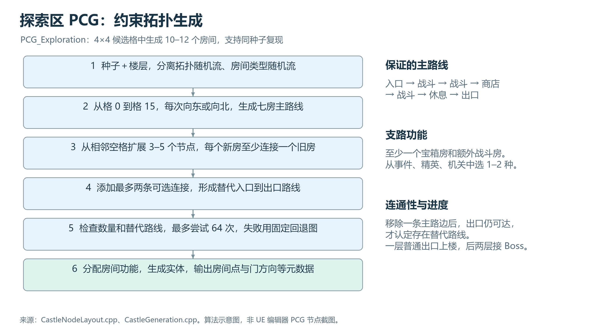

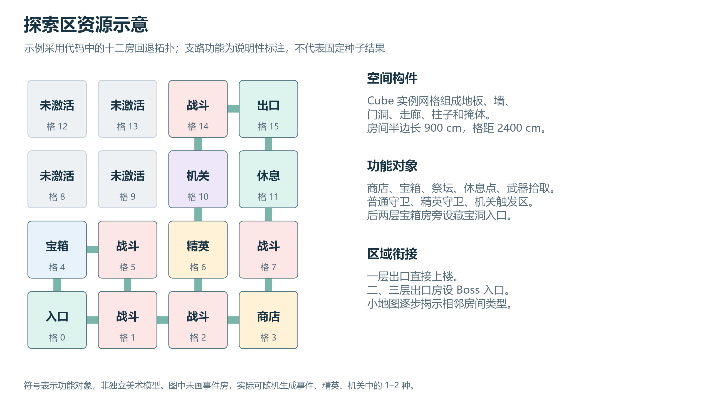

资源示意采用代码的十二房回退拓扑，支路功能用于说明，不声称是指定种子的真实完整资源配置。

### 6.2 藏宝洞

候选格为 2 列×3 行，共 6 格。DFS 枚举所有经过四个不同格子的简单路径，用区域随机流选择一条；只激活四房、连接相邻次序的三条边。入口与出口度数为 1，中间两房度数为 2，因此奖励位于贯通路径上。

房间半边长 800 cm，中心距 2100 cm。第 2、3、4 房各放一个藏品宝箱，共 3 个，出口房也有宝箱。两个中间房各生成“楼层数”个守卫，二层共 4 个、三层共 6 个；各有一组掩体。返回门仅在末房。进入时朝向下一房，离开后保留属性、探索进度和领取状态。

种子 1337 的已有二层记录路径为 1→3→2→0。图中格子连接依该记录，物件坐标为示意。入口不提供返回门，无需折返取得支路奖励。

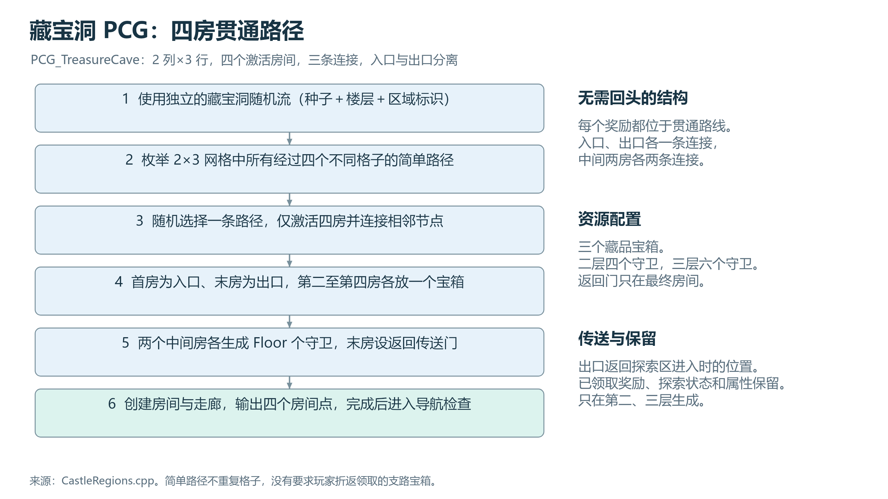

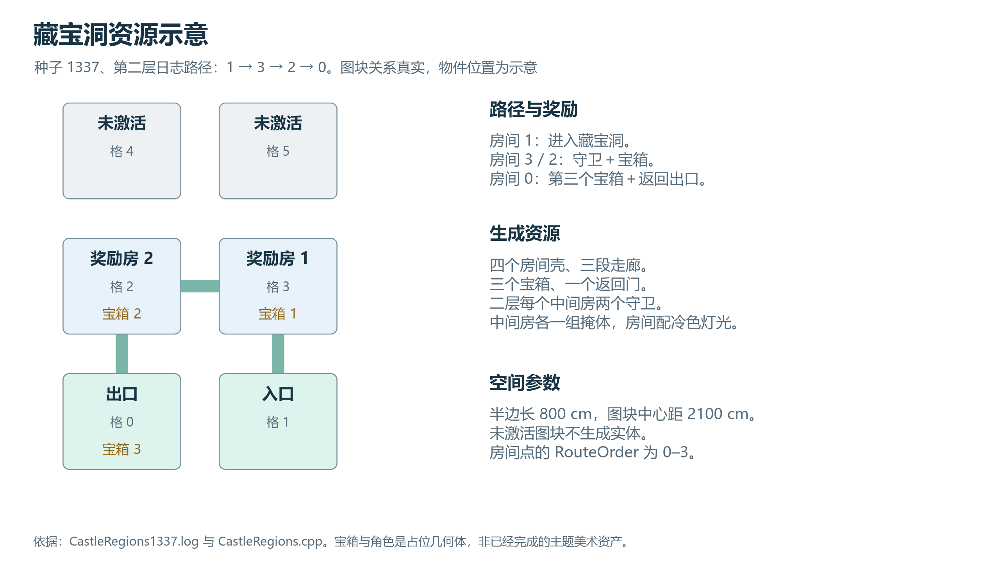

### 6.3 Boss 场地

一个 4500×4500 cm 场地；打乱四角位置，选择 2–4 角放高台。高度在 160、240、320 cm 中选择；平台约 700×850 cm，各接宽 600 cm 的坡道，接头有重叠以防缝隙，每个平台额外带一组掩体和灯光。

默认基础掩体 10 组，运行时限制 4–18 组。形状随机选矮墙（100 cm）、立柱（300–440 cm）或 L 形墙（220 cm）。L 形可由两个网格构成，所以“掩体组数”不等于网格实例总数；平台掩体另计。

放置一个初始未激活 Boss 和一个补给点，保留入口至 Boss 的中央通路。输出场地中心、高台、掩体点。高台、坡道与掩体的组合产生空间变化；Boss 区不是多房迷宫。

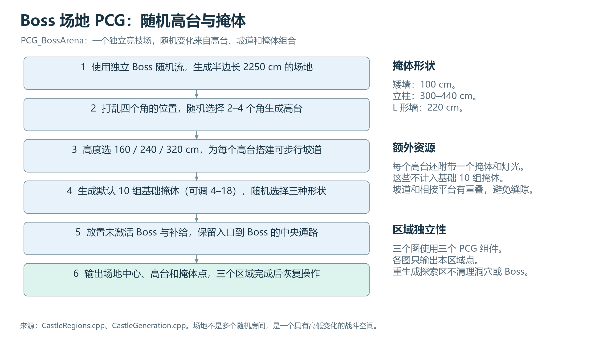

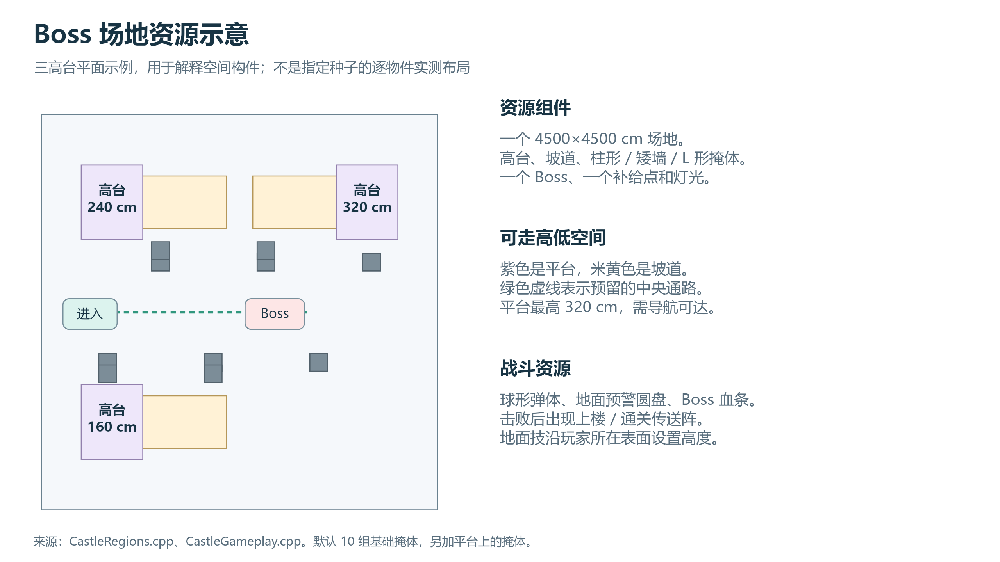

## 7. 两种 AI 的行为与数值

普通与 Boss 都来自 ACastleEnemy，以 bBoss 区分；使用 AIController、动态 Recast 导航、MoveToActor 和射线视线检测。没有巡逻、主动返巢、视野锥 AIPerception 或实际 UE Behavior Tree／Blackboard 资产。商店是交互道具，不是第三种 AI NPC。

附图忠实抽象 Tick 中的条件检查。移动、攻击和 Boss 技能可在同帧独立检查，不能解读为互斥 Selector 分支。

### 7.1 普通守卫（精英复用）

运行前检查存活、玩家与导演有效、生成完成；未激活、玩家死亡或胜利时停止移动。新决策范围要求距玩家 ≤2100 cm，且玩家到 NPC 出生点的二维距离 ≤2600 cm。范围外只跳过本帧新决策，不主动返回出生点。

每 0.45 秒检查移动：距离 >450 cm 或视线受阻则寻路追赶，接近阈值 320 cm；否则停止。朝向玩家。有视线且攻击冷却到期时，每 1.9 秒攻击一次；距离 <140 cm 为近战，否则发射一枚速度 850 cm/s 的弹体。

| 数值 | 第一层 | 第二层 | 第三层 |
| --- | --- | --- | --- |
| 普通生命 | 85 | 105 | 125 |
| 普通伤害 | 10 | 13 | 16 |
| 精英生命（×1.8） | 153 | 189 | 225 |
| 精英伤害（×1.25） | 12.5 | 16.25 | 20 |

普通移动速度 270 cm/s；精英沿用相同行为。

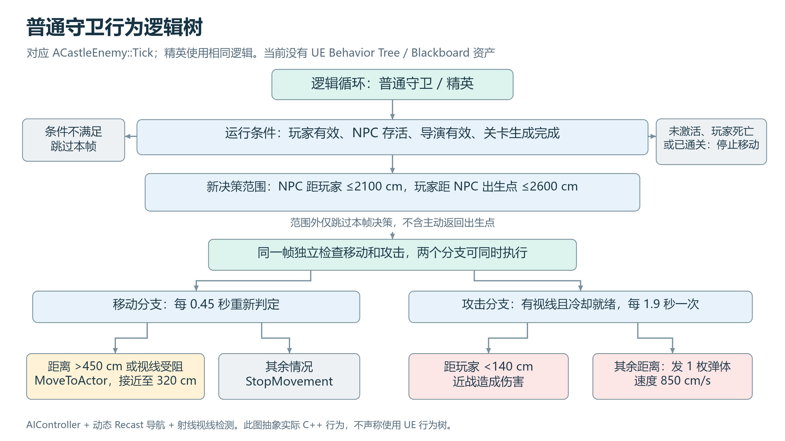

### 7.2 Boss

Boss 只在第二、三层出现，进入竞技场后激活。新决策范围为距玩家 ≤3600 cm。每 0.45 秒检查移动：距离 >650 cm 或视线受阻时追赶，接近阈值 500 cm；否则停止。

有视线且普通攻击冷却到期时攻击。生命 ≥50% 间隔 1.35 秒，远程 3 枚弹体；生命 <50% 间隔 0.85 秒，远程 5 枚弹体。弹幕间隔角 9°，速度 1000 cm/s；距离 <140 cm 用近战。

独立地面技能不要求视线，处于新决策范围内、未蓄力且 6 秒冷却到期时触发：向玩家脚下射线定位，显示红圈，等待 1.4 秒；二维半径 400 cm，玩家脚底高度差 <160 cm 才命中，伤害为普通伤害×2.4。冷却从触发时计算。已到期技能结算在距离检查之前，所以触发后离开 3600 cm 范围仍可能结算。

| 数值／名称 | 第二层 | 第三层 |
| --- | --- | --- |
| 名称 | 灰烬摄政王 / The Ash Regent | 空寂之王 / The Hollow King |
| 生命 | 775 | 1050 |
| 普通伤害 | 22 | 26 |
| 地面技能伤害 | 52.8 | 62.4 |
| 移动速度 | 220 cm/s | 220 cm/s |
| 角色比例 | 1.8 | 1.8 |

两层 Boss 是同一行为体系的名称与数值变体，不应统计为两套独立 AI。击败后奖励 80 金币及上楼／通关出口。

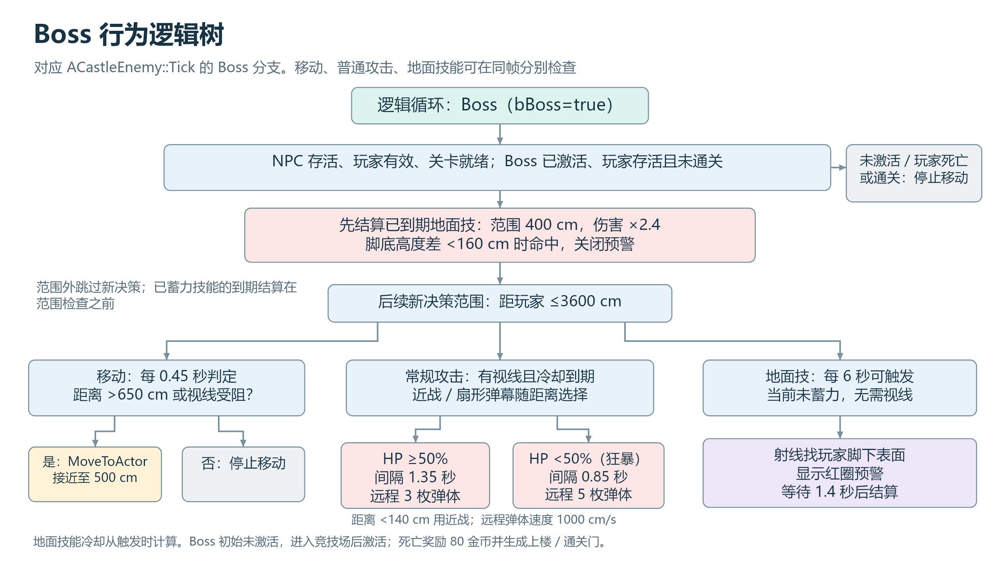

## 8. 美术、场景与 UI 资源

| 网格 | 当前用途 |
| --- | --- |
| Cube | 地板、墙、走廊、坡道、平台、掩体、枪、角色身体及交互台座等 |
| Sphere | 头盔、弹体、闪光和天空等 |
| Cylinder | 地面技能预警圆盘等 |

12 个 Demo 材质：M_Floor、M_Trim、M_Stone、M_Gold、M_Teal、M_Purple、M_Cave、M_Portal、M_Metal、M_Enemy、M_Danger、M_Sky。当前使用基础颜色／发光与粗糙度设置，几何体是功能占位；尚不能称为完成版古堡或机关城模型与贴图库。

UI 已包含种子输入与开始界面、生命护盾、弹药、金币、藏品计数、小地图、Boss 血条、帮助、暂停、死亡及胜利界面。F2 中英切换并保存语言选择。UI 功能不等同于独立图标资产数量。

Plugins/RoguelitePrototype 的模块房间、门与走廊创作系统及 5 个开发地图属于同学新增的独立测试框架；本文主玩法统计依据 CastleDemo，不把该框架当作已接入的第四种 PCG 地图。

## 9. 已有游戏截图

以下是项目已有的 2026-10-10 截图原样副本，用于补充示意图的游戏画面。这次整理没有重新启动 UE 做全流程运行验证。不要把截图当作三种主题美术的成品效果。

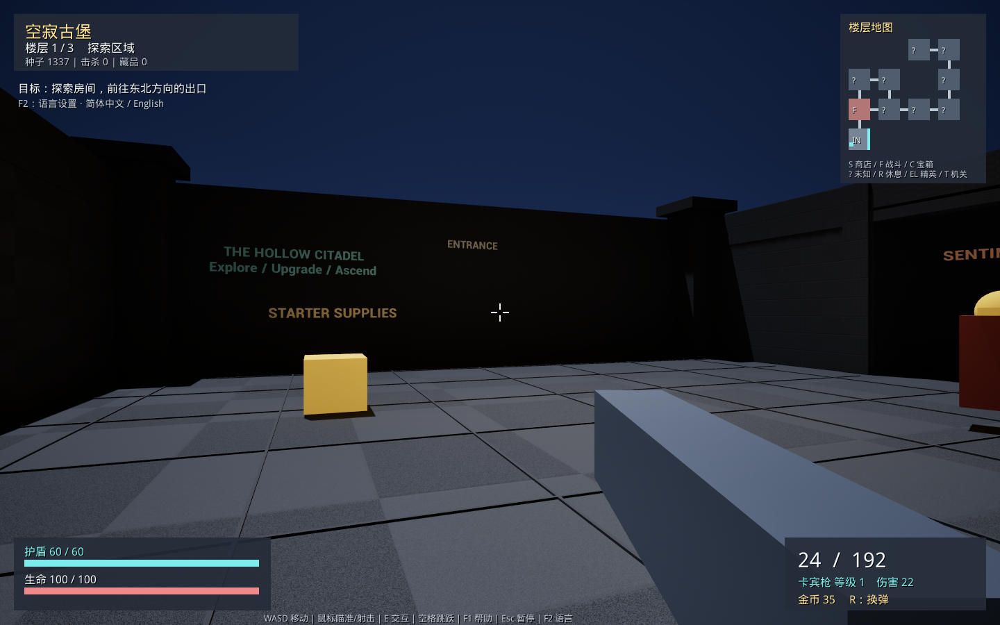

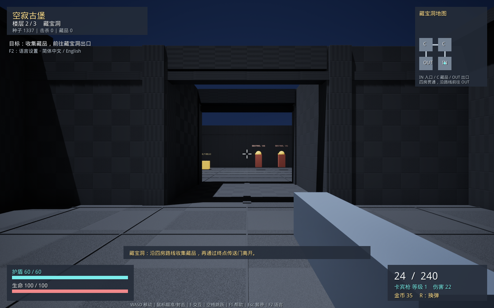

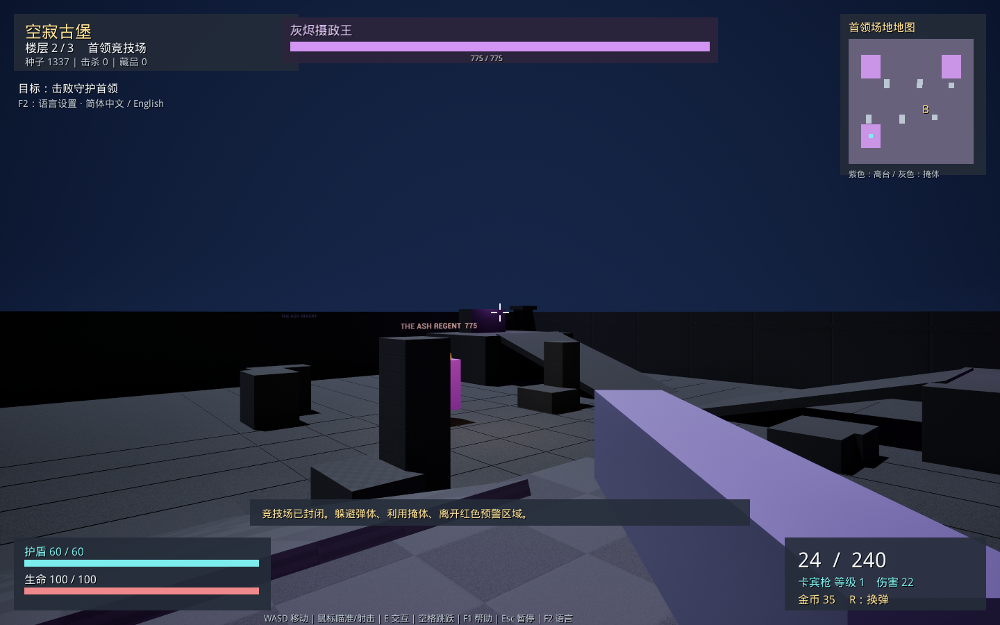

## 10. 汇报顺序建议

1. 用数量表介绍目前 demo 范围：三楼层、三个 PCG 区域、三种藏品、两种 AI。
2. 依次放三组“生成逻辑＋资源示意”，突出各区域目标：探索选择、贯通奖励、立体战斗。
3. 用两张行为逻辑树介绍守卫追击与 Boss 的弹幕、狂暴、地面技能。
4. 用藏品和交互表解释成长与资源循环，随后展示实际截图。

可直接用于口头汇报的表述：“我们通过同一关卡中的三个独立 PCG 图组织探索、奖励与 Boss 战，采用可复现的种子随机生成。探索区兼顾主路线与替代路线，藏宝洞确保四房贯通，Boss 区通过平台、坡道和掩体提供高低变化。AI 当前以 C++ 条件逻辑实现两种行为，分别是守卫与 Boss，图中展示的是对应的行为逻辑树。”

## 11. 核对依据与范围

| 内容 | 主要项目文件 |
| --- | --- |
| 玩家、藏品、交互、敌人行为 | Source/CastleDemo/CastleGameplay.cpp、CastleDemo.h |
| 探索拓扑、主路线与房间类型 | Source/CastleDemo/CastleNodeLayout.cpp |
| 藏宝洞与 Boss 场地 | Source/CastleDemo/CastleRegions.cpp |
| 三图生成调度与完成补给 | Source/CastleDemo/CastleGeneration.cpp |
| PCG 图、地图与材质初始化 | Source/CastleDemo/CastleSetup.cpp |
| HUD 与语言 | Source/CastleDemo/CastleHUD.cpp、CastleMenu.cpp、CastleLanguage.cpp |
| 历史区域路径及隔离检查 | Saved/Logs/CastleRegions1337.log、CastleRegionsIsolation42.log |

统计基于源码与资产清单；三张资源布局图有明确示意标签。PNG 已检查文字与布局，提供 SVG 便于后续调整。没有修改游戏实现。
